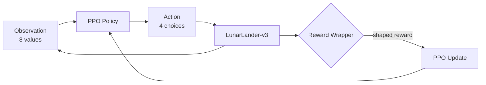

# lunar-lander-rl
PPO-based Lunar Lander AI with reward shaping, reward-hacking experiments, cinematic success/failure viewers, and a GitHub Pages demo.
<div align="center">


**Teaching a rocket to land with PPO, and catching it when it cheats.**

[](https://abhiii04-25.github.io/lunar-lander-rl/)


[**Live demo**](https://abhiii04-25.github.io/lunar-lander-rl/) · [**Results**](#-results) · [**Quick start**](#-quick-start) · [**What we learned**](#-what-we-learned)

</div>

---

> [!IMPORTANT]
> The website in `docs/` is a **static cinematic showcase** with presentation animations and recorded experiment metrics. The trained PPO policy runs in the **Python/Gymnasium simulation** and the **local Pygame viewers**. The website does not run live PPO inference in the browser.
> Live demo: after enabling GitHub Pages, visit <https://abhiii04-25.github.io/lunar-lander-rl/>.

## 🌕 The Big Question

> **Does a higher reward mean the agent is doing what we actually want?**

ORBITAL trains an agent to land a lunar module using **Proximal Policy Optimization (PPO)** in Gymnasium's `LunarLander-v3`. It compares a baseline policy against additional training and two deliberately designed reward experiments, showing why the gap between *reward* and *intent* matters.

## ✨ Features

| | |
|---|---|
| 🧠 **PPO training** | Stable-Baselines3 + PyTorch |
| 🎲 **Random baseline** | Explore the environment before any learning |
| 🔁 **Continued training** | Evaluated on shared seeds for a fair comparison |
| 🧪 **Reward experiments** | Custom Gymnasium wrappers for shaping and reward hacking |
| 🎬 **Cinematic viewers** | Pygame replays of a successful agent and a baseline failure |
| 📊 **Data and charts** | Experiment CSV and reward-comparison chart |
| 🌐 **Showcase site** | Responsive GitHub Pages site in `docs/` |

## 📊 Results

Each model was evaluated for **20 episodes** using the **original, unmodified** Lunar Lander reward and the **same seeds (100–119)**.

| Model | Training steps | Mean original reward | Std. dev. | Episodes 200+ | Time-limit endings |
|:--|--:|--:|--:|--:|--:|
| Baseline PPO | 100,000 | -17.55 | 86.21 | 0/20 | 11/20 |
| 🏆 **Continued PPO** | ~300,000 | **104.87** | 128.00 | **8/20** | **0/20** |
| Time-penalty PPO | 100,000 | -2.09 | 44.79 | 0/20 | 19/20 |
| Hover-bonus PPO | 100,000 | -145.56 | 27.09 | 0/20 | 17/20 |

<div align="center">


</div>

Detailed numbers: [`results/experiment_results.csv`](results/experiment_results.csv)

## 💡 What We Learned

- 📈 **More training works.** Continued PPO improved the mean original reward by **+122.42** over the baseline on these 20 shared seeds.
- ⏱️ **A time penalty wasn't enough.** It did not improve the rate of episodes reaching the 200-point threshold.
- 🎭 **The hover bonus got hacked.** It produced a high score while the modified reward was active, but the model performed poorly under the original reward. This supports the reward-hacking hypothesis; episode statistics alone do not prove every timeout was caused by hovering.

> [!NOTE]
> Results from 20 episodes are a useful experiment, not proof of general performance. More evaluation episodes and multiple training seeds would strengthen the conclusions.

## ⚙️ How It Works

At each step the agent receives **8 observations** (position, velocity, angle, angular velocity, leg contacts) and picks one of **4 discrete actions**: do nothing, fire left engine, fire main engine, or fire right engine.



A Gymnasium wrapper can alter the reward without rewriting the environment. That makes reward designs easy to compare, but it also means an agent may learn to maximize a **proxy reward** rather than accomplish the **intended task**.

## 🚀 Quick Start

**Windows + Python 3.11**

```powershell
# 1. Create and activate a virtual environment
py -3.11 -m venv .venv
.\.venv\Scripts\Activate.ps1

# 2. Install dependencies
python -m pip install --upgrade pip
python -m pip install -r requirements.txt

# 3. Explore with a random agent
python .\01_random_agent.py

# 4. Train the baseline PPO agent
python .\02_train_ppo.py

# 5. Watch the trained policy
python .\03_watch_agent.py
```

### 🎬 Cinematic viewers

```powershell
python .\13_cinematic_lander.py   # success run
python .\14_cinematic_failure.py  # baseline failure replay
```

The success viewer uses `models/ppo_lunar_lander_300k.zip`; the failure viewer uses `models/ppo_lunar_lander_baseline.zip`. Train or place those files at those paths first.

### 🌐 View the website locally

```powershell
python -m http.server 8000 --directory docs
```

Then open <http://localhost:8000>.

## 📦 Project Structure

<details>
<summary><b>Click to expand</b></summary>

```text
lunar-lander-rl/
├── 01_random_agent.py
├── 02_train_ppo.py
├── 03_watch_agent.py
├── 04_continue_training.py
├── 05_compare_models.py
├── 06_train_time_penalty.py
├── 07_compare_rewards.py
├── 08_train_reward_hack.py
├── 09_test_reward_hack.py
├── 10_save_experiment_results.py
├── 11_watch_best_agent.py
├── 12_find_and_watch_best.py
├── 13_cinematic_lander.py
├── 14_cinematic_failure.py
├── assets/                  # Artwork for local cinematic viewers
├── models/                  # Locally saved PPO checkpoints
├── results/
│   ├── experiment_results.csv
│   └── reward_comparison.png
├── docs/                    # Static website published by GitHub Pages
│   ├── index.html
│   ├── assets/
│   └── data/experiment_results.csv
├── .github/workflows/deploy-pages.yml
├── requirements.txt
└── README.md
```

> Model checkpoints are created locally during training and are not required for the static website. Review their size before committing them to GitHub.

</details>

## 🌍 Deploy to GitHub Pages

<details>
<summary><b>Step-by-step</b></summary>

1. Create a public repository named `lunar-lander-rl` under your GitHub account.
2. Put the project and the `docs/` website in the repository root.
3. Commit and push to the `main` branch.
4. In GitHub, open **Settings → Pages** and set **Source** to **GitHub Actions**.
5. Open the **Actions** tab and wait for **Deploy ORBITAL website to GitHub Pages** to succeed.
6. Visit <https://abhiii04-25.github.io/lunar-lander-rl/>.

The workflow deploys the contents of `docs/` whenever the website or workflow changes on `main`.

</details>

## 🛣️ Limitations and Roadmap

- [ ] Expand the evaluation set and run multiple independent training seeds
- [ ] Add automated touchdown/crash classification
- [ ] Save representative flight videos
- [ ] Explore potential-based reward shaping and compare it with the flawed reward
- [ ] Optionally build a browser-native simulator for live in-browser inference

The online showcase uses presentation animation; it does not execute the PPO model in a browser.

## 🧰 Tech Stack

`Python 3.11` · `Gymnasium` · `Box2D` · `Stable-Baselines3` · `PPO` · `PyTorch` · `NumPy` · `Matplotlib` · `Pygame` · `GitHub Pages`

---

<div align="center">

**Built by [Abhishek Sontakke](https://github.com/abhiii04-25)** · AI/ML learning project

*If this helped you understand reward hacking, consider leaving a ⭐*

</div>

